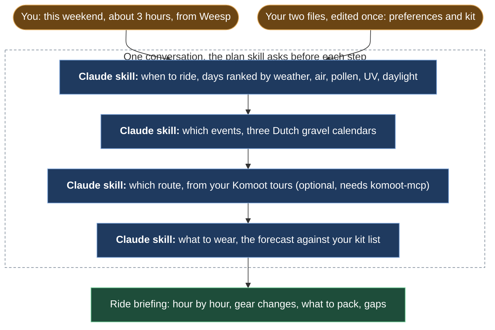

# gravel-ride-plan

Five Claude Code skills that plan a gravel ride near Amsterdam from one prompt: when to ride, which events are on, which route, what to wear, and a briefing you can read at the door.

## Preview

```
You:    /gravel-ride-plan this weekend, about 3 hours, from Weesp

Claude: Step 1, when to ride. Saturday and Sunday compared:
        Saturday: feels-like 9 to 12 C, wind 10 km/h ENE, no rain, UV 3.8, AQI good.
        Sunday: 7 to 10 C, gusts to 45 km/h on the dikes, rain from 14:00.
        Verdict: Saturday, 12:00 to 15:00. One gravel event that day: a club ride
        from Utrecht at 10:00, 60 km.
        Ready for the next step?

You:    yes, build me a route

Claude: Step 2, where to ride. From 14 saved tours near Weesp I combined the gravel
        sections into a 54 km loop, 68% gravel, 3 road connectors (4 km), passing
        Ankeveense Plassen and Fort Uitermeer. GPX saved. Upload to Komoot?
        ...

        ## Ride Briefing: Saturday 17 Oct, 12:00 to 15:00
        | Time  | Feels-like | Wind   | Cloud | UV  | Gear change                 |
        | 12:00 | 9 C        | 8 ENE  | 0%    | 3.8 | Start: merino, jersey, vest |
        | 13:00 | 11 C       | 10 ENE | 0%    | 4.1 | Pocket the vest             |
        Pack: second bidon, sunscreen. Gaps: none.
```

## What it does



1. `gravel-ride-plan` runs the guided flow and writes the final briefing.
2. `gravel-ride-timing` ranks the candidate days from weather, air quality, pollen, UV and daylight, then finds the best 2 to 4 hour window.
3. `gravel-ride-events` scrapes three public Dutch gravel calendars for rides in that window.
4. `gravel-route-builder`, optional, recommends saved Komoot tours by gravel share and scenery, or builds a new route from their best gravel sections. It needs [komoot-mcp](https://github.com/nunomnferreirapt/komoot-mcp); without it the plan asks for the route you have in mind and moves on.
5. `gravel-ride-gear` turns the forecast and your own kit list into what to wear, what to pocket, and what you are missing.

**Constraints:** nothing about you is in the skills. Preferences and kit live in two files you edit once, and every skill reads them at run time.

## Why this exists

I ride gravel around Amsterdam, and planning a ride used to mean five tabs: weather, pollen, an events calendar, Komoot and a guess at clothing. I built these skills so the whole thing happens inside Claude, in one conversation, with my own preferences and kit on file.

## Requirements

- Claude Code with skills enabled
- [uv](https://docs.astral.sh/uv/) to run the two Python scripts (their dependencies are declared inline, so no install step)
- MCP servers, registered in Claude Code:
  - [komoot-mcp](https://github.com/nunomnferreirapt/komoot-mcp), optional, for the route step (needs a Komoot account). Without it the other four skills still run
  - `geocoding-mcp`, `sun-weather-mcp`, `air-quality-mcp` for places, forecasts, air quality, pollen and UV, used by the timing, gear and route skills: [public-mcp-servers](https://github.com/nunomnferreirapt/public-mcp-servers). Events and plan run without them

## Install

```bash
git clone https://github.com/nunomnferreirapt/gravel-ride-plan.git
cd gravel-ride-plan
mkdir -p ~/.claude/skills
ln -s "$PWD"/skills/gravel-* ~/.claude/skills/
```

Use `cp -R` instead of `ln -s` if you prefer a copy. Then edit two files once:

- `~/.claude/skills/gravel-ride-timing/preferences.md`: home base, driving radius, comfort thresholds, routes folder
- `~/.claude/skills/gravel-ride-gear/references/gear-inventory.md`: what you own; `NONE` marks a gap

To run the tests: `uv sync && uv run pytest`.

## Usage

In Claude Code type `/gravel-ride-plan` with the when, how long and where you have in mind. Each skill also works alone: `/gravel-ride-timing this weekend`, `/gravel-ride-events next two weeks`, `/gravel-route-builder 50 km loop from Weesp, mostly gravel`, `/gravel-ride-gear for Saturday 12:00`.

## How five skills share one preferences file

Each skill is a `SKILL.md` with numbered steps that Claude follows, plus any script or reference file it needs. The plan skill chains the others and asks before each step. Timing pulls all MCP data in one parallel call and ranks days as a spectrum instead of filtering; the hourly window comes from Open-Meteo through `hourly_weather.py`. Events come from `scrape_events.py`, which reads Battistrada, the Maats.cc Shopify API and Ride Out Amsterdam and returns JSON. The route builder, when `komoot-mcp` is registered, scores Komoot tours or asks the server to combine their gravel sections; when it is not, the plan takes the route you name and goes on to gear. Gear reads your inventory file and applies layering rules by feels-like temperature, wind and rain, flagging anything marked `NONE`. Preferences live in one markdown file that every skill reads at run time, so nothing about you is hard-coded in the skills.

## Repository layout

```
skills/
  gravel-ride-plan/SKILL.md
  gravel-ride-timing/SKILL.md, preferences.md, scripts/hourly_weather.py
  gravel-ride-events/SKILL.md, scripts/scrape_events.py
  gravel-ride-gear/SKILL.md, references/gear-inventory.md
  gravel-route-builder/SKILL.md
tests/            pytest for the two scripts, no network
pyproject.toml    uv project for the tests
```

## License

MIT, see `LICENSE`.

Built by [Nuno Ferreira](https://www.linkedin.com/in/nunomnferreira).
